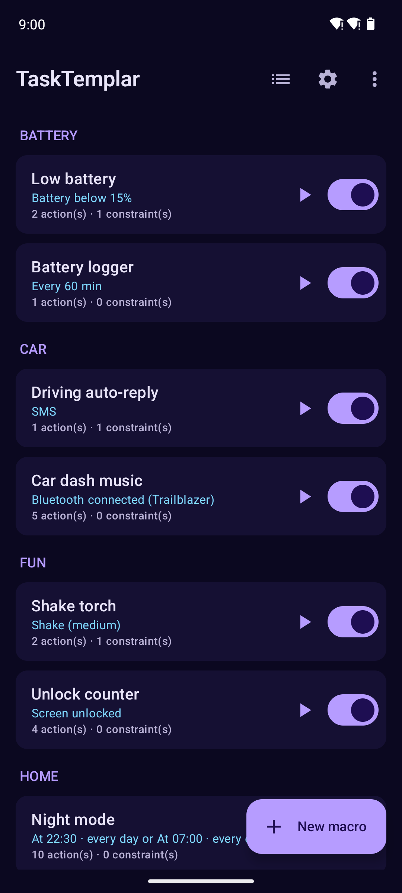
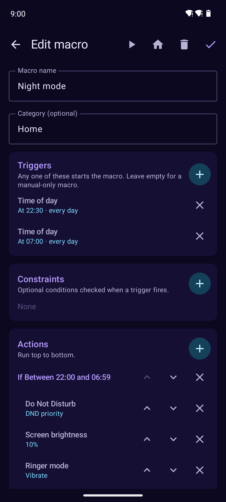
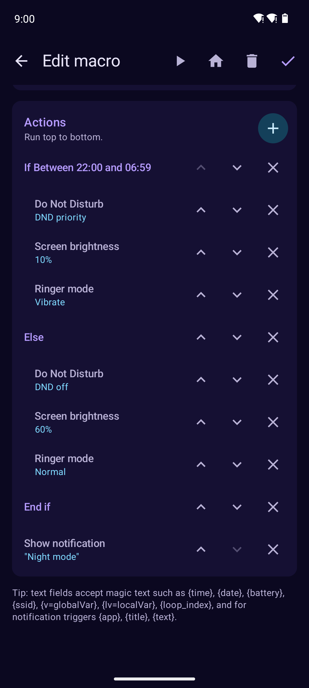
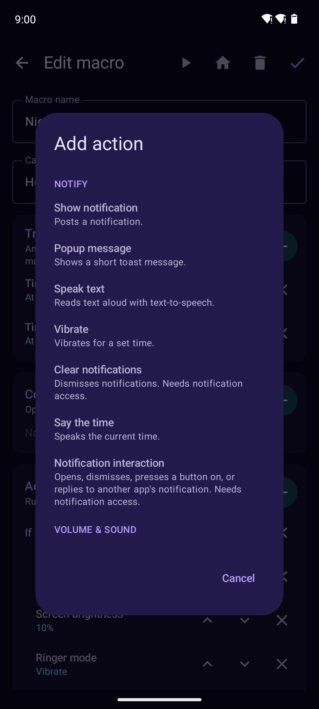
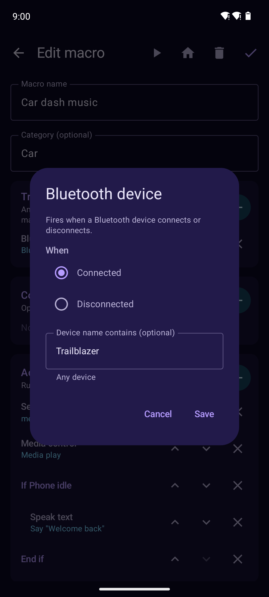
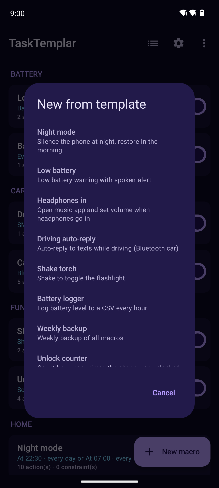
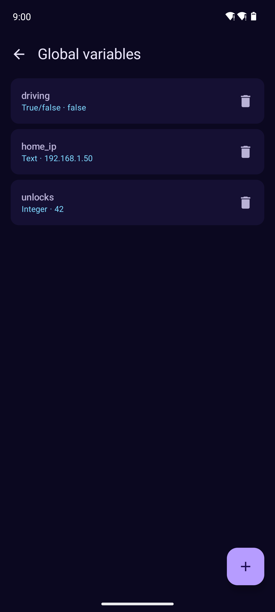
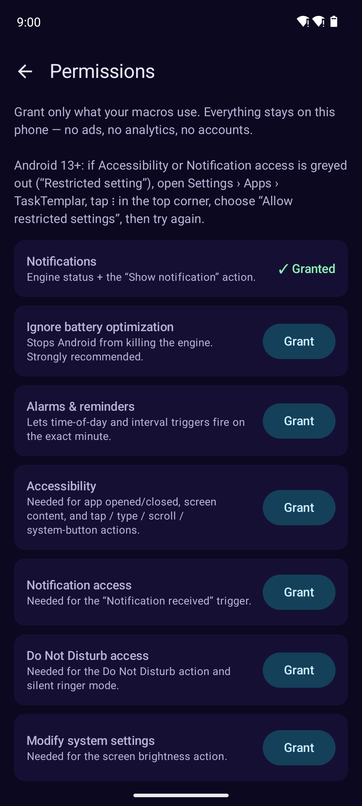
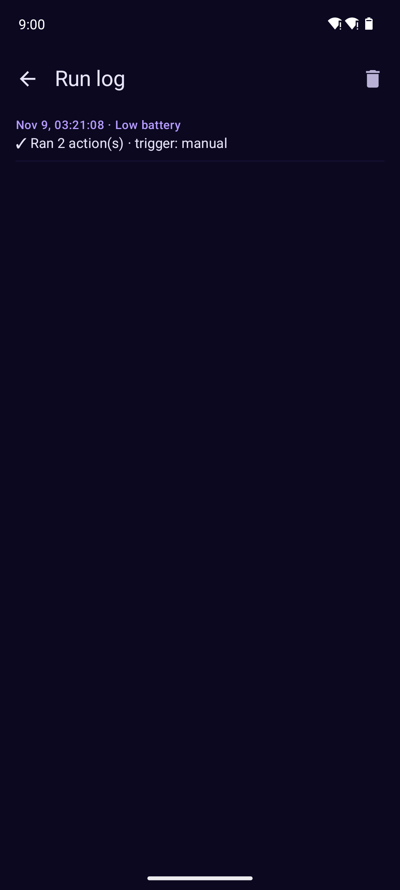

<h1 align="center">TaskTemplar</h1>

An ad-free, tracker-free automation app for Android in the spirit of MacroDroid.
Build **macros** out of three parts:

- **Triggers**: *when* something happens (any one starts the macro)
- **Constraints**: *only if* conditions are right (all, or any, must pass)
- **Actions**: *do* these things, top to bottom

No ads, no analytics, no accounts, no network calls except the HTTP actions you create yourself.
Parity progress against MacroDroid is tracked in [PARITY.md](PARITY.md).

Macros live in a JSON file on the phone and can be exported or imported from the ⋮ menu.

## Screenshots

| Macros | If / Else editor | Actions |
|---|---|---|
|  |  |  |
| **Add action** | **Step settings** | **Templates** |
|  |  |  |
| **Global variables** | **Permissions** | **Run log** |
|  |  |  |

## What's in v0.1

| Triggers | Constraints | Actions |
|---|---|---|
| Time of day (with weekdays) | Time window (crosses midnight) | Show notification |
| Regular interval | Day of week | Popup (toast) |
| Device boot | Battery above/below | Speak text (TTS) |
| Screen on / off / unlocked | Charging / not charging | Vibrate |
| Battery level crosses N% | Wi-Fi connected (optionally SSID) | Ringer mode |
| Power connected / disconnected | Screen on / off | Do Not Disturb mode |
| Wi-Fi connected / disconnected (optional SSID) | | Set volume (media/ring/notif/alarm) |
| Bluetooth device connected / disconnected | | Screen brightness |
| Headphones plugged / unplugged | | Flashlight on/off/toggle |
| Notification received (app + text filter) | | Copy to clipboard |
| | | Launch app |
| | | Open website |
| | | HTTP GET/POST (webhooks, home server) |
| | | Wait |

**Logic (v0.2)**: If / Else If / Else / End If, Loop (N times, while, forever) with Break / Continue,
Stop, global and local variables (integer, decimal, true/false, text) with math expressions,
text manipulation, run / enable / cancel other macros, a "Variable changed" trigger and
"Variable value" / "Macro enabled" constraints. Global variables have their own screen (⋮ menu).

**Screen control (v0.3)**: with Accessibility turned on, macros can react to apps opening or
closing and to text appearing on screen, and can tap / long-press elements (by text, view id or
coordinates), type into fields, scroll, swipe, read the screen into a variable, and press Back,
Home, Recents, notification shade, quick settings, power menu, lock screen and screenshot.
Plus: app installed/removed/updated trigger, app-in-front and notification-present constraints,
go home, kill background app and clear notifications actions.

**Phone, SMS & location (v0.4)**: call trigger (incoming, answered, outgoing, ended, missed),
SMS received, geofence enter/leave and sunrise/sunset triggers. All location features use
Android's own LocationManager, so they work on de-Googled phones. Constraints: call state,
inside/outside a place, day of month, month. Actions: make / answer / end call, speakerphone, send SMS,
compose email, open call log, and get location (`{lat}`, `{lng}`, `{location_url}`).

**Sensors & device control (v0.5)**: shake, flip, proximity, orientation, music playing,
ringer mode changed, volume buttons, airplane / location services changed, dock, USB device and
battery temperature triggers (sensors only run while a macro needs them). About 16 new
device-state constraints. Actions: Wi-Fi / Bluetooth / mobile data / airplane toggles (with root on
newer Android, otherwise they open the right settings panel), auto-rotate, screen timeout, keep
awake, screen on, media keys, volume up/down, play / stop sound, set alarm clock, car mode,
wallpaper, and a shell-command action with optional root.

**Launchers & dialogs (v0.6)**: home-screen shortcuts (🏠 in the editor), a home-screen widget,
three quick-settings tiles, draggable floating buttons, buttons on the status notification,
"Intent received" (for Tasker, Termux, adb…) and a **local-network webhook**
(`http://PHONE-IP:8765/hook/NAME?token=…`) that your home server can call. Dialog actions: message,
option list (`{option}`), yes/no confirm (`{confirmed}`, can stop the macro), text input, plus Send intent.

**More triggers (v0.7)**: day of month, calendar events (`{event_title}`), stopwatch / countdown,
weather (Open-Meteo: no account, no key), power-button presses, media/headset buttons, light level,
edge swipes, NFC tags, failed unlock (device admin), data-connection changes, VPN, hotspot, auto-sync,
screensaver, Wi-Fi network in range, SMS sent and clipboard changed. New constraints: logic groups
(AND / OR / NOT / NAND), light level, proximity, stopwatch value, hotspot, VPN, auto-sync. New actions:
Stopwatch (`{sw=name}`) and Get weather (`{temp}`, `{weather}`…).

**Everything else (v0.8)**: array and dictionary variables (`{v=list[0]}`, `{v=dict[key]}`, `{v=list[#]}`),
action blocks (Run macro → “Run here as an action block”), mobile-signal and cell-tower triggers, notification
interaction (open / press button / reply / dismiss), set ringtone, vibrate-when-ringing, dim-screen overlay,
keyboard picker, voice command, screensaver, launch activity, file actions (write / read / copy / move /
delete / open / upload), UDP packets, clear call log, add calendar event, say the time, clear log, and
Back up macros. Plus macro **categories**, a local **template library** (⋮ → New from template) and
**saved places** (★ next to any location field).

**Media & plugins (v0.9)**: silent Take photo and Record microphone actions (`{photo_path}`, `{audio_path}`),
a host for **Tasker / Locale action plugins** (AutoTools, AutoInput, Join…), and LED-blinking notifications.

**Import from MacroDroid & Tasker (v0.10)**: ⋮ → *Import from MacroDroid / Tasker* reads MacroDroid exports
(`.macro`, `.mdr`, `.category`) and Tasker exports (profile, task or project `.xml`, or a full backup).
Around 50 MacroDroid triggers, 35 constraints and 70 actions convert directly, including If / Else / loops,
variables and `[v=name]`-style magic text. Tasker profiles become macros (exit tasks become a second macro),
with Time / Day / App / Location / Event / State contexts, ~60 actions, If / Else / For, conditional actions,
`%VARIABLES` and Locale plugin actions carried over. Imported macros arrive **switched off** in an “Imported”
category, and a report lists anything that needs a manual touch.

**Magic text**: text fields accept `{time}`, `{date}`, `{battery}`, `{ssid}`, `{macro}`, `{trigger}`;
notification triggers add `{app}`, `{title}`, `{text}`; Bluetooth adds `{device}`; and after an
HTTP action, later actions can use `{http_code}` and `{http_body}`. Variables: `{v=name}` (global),
`{lv=name}` (local), `{loop_index}` inside loops.

Every macro has a ▶ button for a test run, and the run log (☰ icon) shows what fired and what failed.

## Getting the APK

Grab the APK from the repo's **Releases** page. A new release is published automatically every time the
app's `versionName` goes up on `main`; every other push still builds an APK you can download from the
workflow run's **Artifacts**.

Or open the folder in Android Studio and hit Run.

> The release build is signed with the debug key so it installs straight away. Use your own
> keystore if you ever distribute it.

## First run

Open ⚙ **Permissions** and grant what your macros need. The important one is
**Ignore battery optimization**, because without it Android may kill the engine.
On some phones (Samsung, Xiaomi and others) you may also need to set the app to
"Unrestricted" battery use in system settings.

## How it works

- `MacroService`: a foreground service that listens for battery, power, screen, headset,
  Bluetooth and Wi-Fi events (Android no longer delivers most of these to sleeping apps).
- `AlarmScheduler`: exact alarms for time and interval triggers, rescheduled after each fire,
  after boot, and whenever macros change.
- `NotifListener`: the notification-access service for notification triggers.
- `MacroEngine`: matches events to triggers, checks constraints, runs actions in a coroutine.
- `Catalog`: one registry of every trigger, constraint and action, including its settings.
  The editor UI builds itself from it, so a new action only needs a spec there plus a branch in
  `Actions.execute`.

## Stack

Kotlin 2.0 · Jetpack Compose (Material 3) · minSdk 26 (Android 8) · targetSdk 34 · no third-party deps
beyond AndroidX and coroutines.

## Credits

The Android robot is reproduced or modified from work created and shared by Google and used according
to terms described in the Creative Commons 3.0 Attribution License. The cross pattée is a historical
public-domain emblem.
